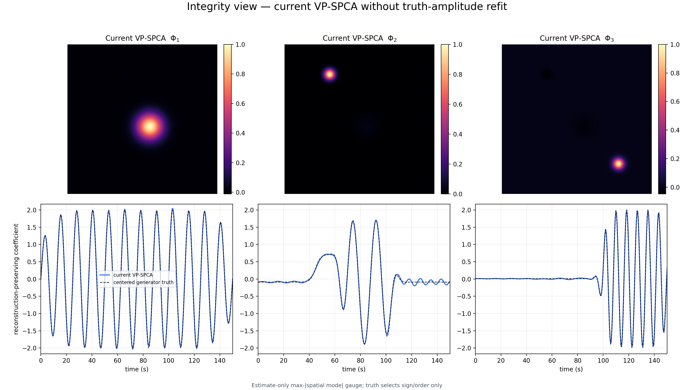
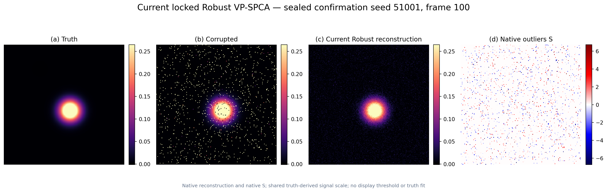
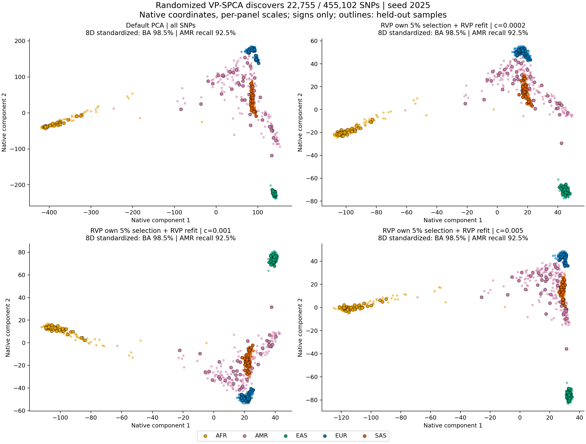
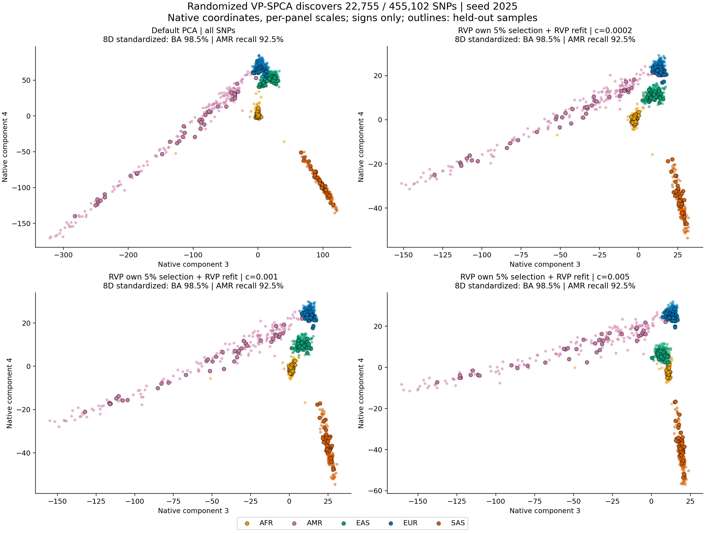

# Sparse and Robust PCA with Variable Projection

University of Macau summer research | Jun-Oct 2025

Implementations and saved results for sparse dimensionality reduction,
synthetic video decomposition, and genomic population stratification.
The project period refers to the original research; later implementation and
validation are included.

## 1. Sparse dimensionality reduction

The VP-SPCA implementation combines restarted FISTA, backtracking, and
matrix-free randomized sketches. Accelerated VP-SPCA reduced subspace error by
**30.7%** versus default scikit-learn PCA on corrupted synthetic data across 12
paired seeds.

[Accelerated solver](src/rspca/accelerated.py) ·
[Randomized solver](src/rspca/randomized.py) ·
[Summary](results/synthetic/default_pca_comparison/paired_replay/summary.json) ·
[Per-seed records](results/synthetic/default_pca_comparison/paired_replay/records.json)

This comparison uses default dense PCA, not a sparsity-matched baseline; it does
not isolate the contribution of random sketches.

## 2. Synthetic video decomposition

### Clean video: three spatial modes and temporal dynamics



[VP-SPCA solver](src/rspca/vp.py) ·
[Saved results](results/video/clean_modes/three_mode_recovery/results.json)

These are native outputs without truth-dependent amplitude refitting. The clean
fit reached its 500-iteration budget without strict convergence.

### Corrupted video: robust reconstruction and sparse outliers



The four panels show truth, corrupted input, reconstruction, and outliers.
This saved continuation/multistart output uses predeclared seed 51001 and frame
100; it is an illustration, not the single-start fit used for the aggregate
comparison below. Shared signal color limits and a separate signed outlier
scale affect display only.

[Huber-based solver](src/rspca/robust.py) ·
[Figure provenance](results/video/robust_decomposition/representative_frame/provenance.json) ·
[20-seed results](results/video/robust_decomposition/confirmation/results.json) ·
[Full-frame errors](results/video/robust_decomposition/confirmation/confirmation_full_frame_errors.csv)

Across 20 paired seeds, single-start robust VP-SPCA reduced mean clean relative
reconstruction error from 0.4332993 to 0.3373443 versus PCA, **about 22%**.
Nominal-budget outlier F1 was lower than PCA's, and the confirmatory effect gate
failed. The full statistics and selection lock are retained.

## 3. Genomic population stratification

The randomized VP-SPCA SNP-selection pipeline retains **22,755 of 455,102 SNPs
(5%)**. Across 20 paired splits, its median within-split workflow-time reduction
versus all-SNP PCA was **29.1%**.

[Pipeline](experiments/genomics_randomized_vp_selected5.py) ·
[20-split summary](results/genomics/selected_snps/paired_splits/summary.json)





The plots show the first registered split (seed 2025), not aggregate scores.
Across all splits, standardized-PC balanced accuracy was 97.475% versus 98.175% for all-SNP PCA;
AMR recall was 88.5% versus 92.0%. Timing includes preprocessing, selection,
panel materialization, refitting, projection, and readouts, but excludes
downloads, upstream QC/LD processing, rendering, and independent audits.
A fixed 50-step VP budget and repeated splits of one 1,000-person cohort do not
establish strict stationarity or external population generalization.

## Install and checks

Python 3.11 or newer:

```bash
python -m pip install -e '.[experiments,dev]'
make test
make cli-check
```

The repository contains the three project components, their required shared
dependencies, tests, four main figures, and supporting numerical records.
Additional figures and the complete research archive are not included.
Historical paths embedded in saved result metadata refer to the original
execution archives, not the current checkout.
Downloaded cohorts, participant-level predictions, and checkpoints are excluded.

Source-only checks do not reproduce the saved benchmarks. Historical rendering
and exact synthetic replay require the original archive and numerical
environment; strict array-hash checks are separate in `make test-historical`.
Source provenance checks use pinned Git objects, so use a full Git clone.

## Reference and license

N. B. Erichson et al.,
[Sparse Principal Component Analysis via Variable Projection](https://arxiv.org/abs/1804.00341).

[MIT License](LICENSE). [Citation metadata](CITATION.cff).
